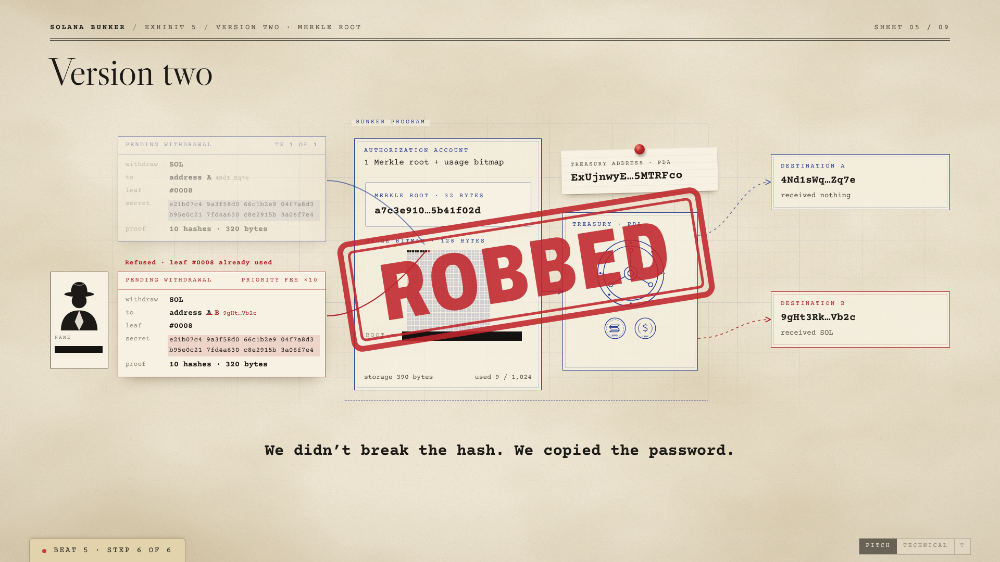
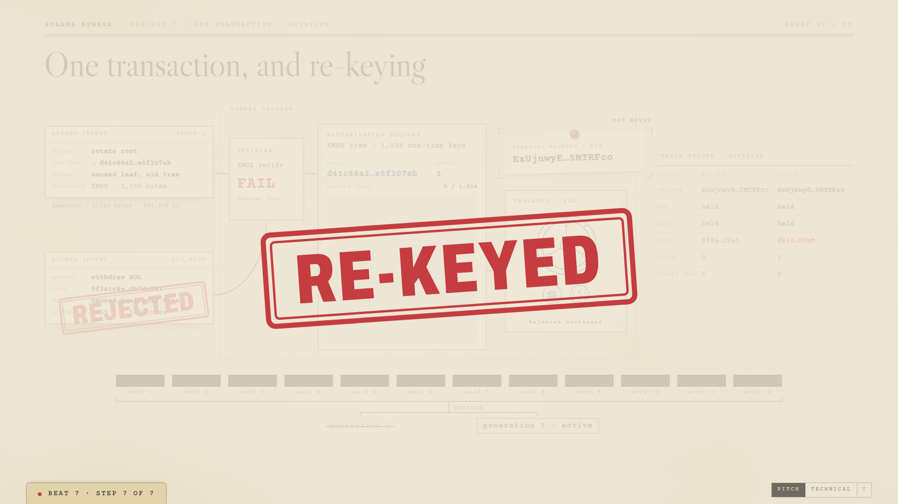
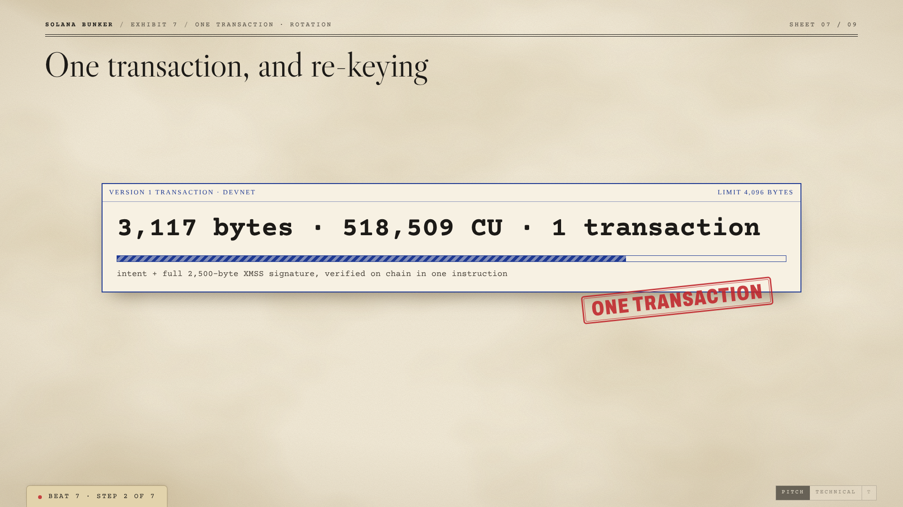
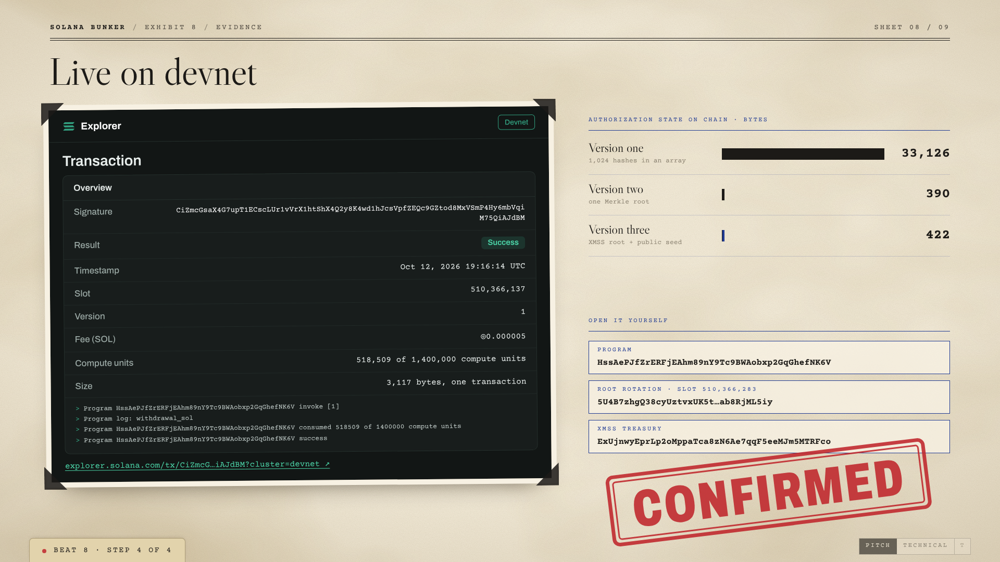
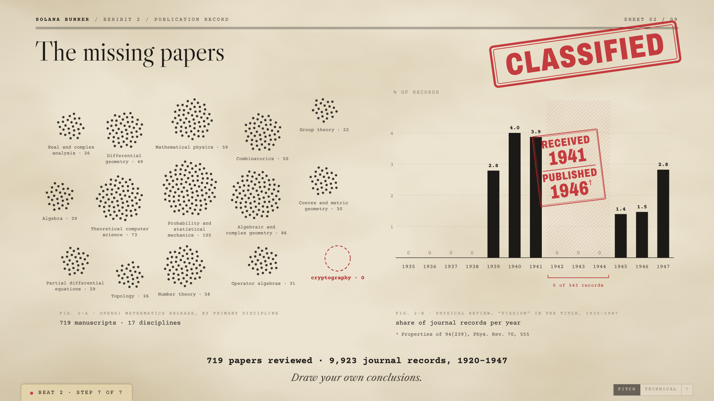

**Solana Bunker** is a research proof of concept for a Solana vault that keeps one receiving address while the cryptography that unlocks it is replaced, ending in XMSS hash-based signatures verified in a single transaction.

[Devnet program](https://explorer.solana.com/address/HssAePJfZrERFjEAhm89nY9Tc9BWAobxp2GqGhefNK6V?cluster=devnet) | [Presentation](https://shared.claude.do/private/solana-bunker-presentation) | [Whitepaper](research/whitepaper.md)

## The question

Can a Solana account keep receiving funds at the same address while the cryptography that unlocks it is swapped out?

The treasury is a program-derived address with no private key. The authorization rule lives in a separate state account and is replaced in three versions, each tested for native SOL and a six-decimal SPL token, Mock USDC.

The ten confirmed devnet operations, 225 runtime assertions and every measurement in the whitepaper come from this repository, and the Reproduce section below rebuilds them with one script.

## Three versions of the lock

**Version one** stores a thousand SHA-256 commitments to one-time secrets. **Version two** commits the same secrets as a single Merkle root. Both are deliberately robbed in a scripted test: a revealed secret is a bearer credential, so an attacker who sees the pending transaction copies it, swaps the destination and lands first. **Version three** signs the full canonical withdrawal with XMSS (RFC 8391, NIST SP 800-208), built from SHA-256 alone, so the copied and edited transaction is rejected on chain.

| Version | What is stored | State bytes at 1,024 leaves | Witness bytes | What the robbery does to it |
|---|---|---:|---:|---|
| 1. Array | 1,024 SHA-256 hashes | 33,126 | 36 | Robbed |
| 2. Merkle | One Merkle root | 390 | 356 | Robbed |
| 3. XMSS | Root and public seed | 422 | 2,500 | Rejected |



Version three also rotates. A signed rotation installs a fresh tree with a new root and the next epoch, at the same address with the same balance, and the old root is rejected afterwards. The BIP39 seed phrase recovers keys, not signing progress; lost or uncertain signing journal state requires abandoning affected leaves or using a fresh tree. The vault tracks spent one-time keys in a bitmap and can burn doubtful keys.



## One transaction

An XMSS signature is 2,500 bytes. With Solana v1 transactions (4,096 bytes) it fits in one transaction together with the exact canonical intent. The instruction is `02 || intent_length:u16LE || exact_canonical_intent || raw_XMSS_signature:2500`, and the limits are requested inline and enforced on devnet. The explicit staged fallback (five transactions) remains available. Measured on devnet, one confirmed transaction per operation:

| XMSS operation | Complete bytes | Confirmed CUs |
|---|---:|---:|
| SOL withdrawal | 3,117 | 518,509 |
| Mock USDC withdrawal | 3,214 | 532,564 |
| Burn two target leaves | 3,086 | 529,687 |
| Rotate XMSS root and public seed | 3,146 | 483,319 |
| New-root SOL withdrawal | 3,117 | 506,910 |
| New-root Mock USDC withdrawal | 3,214 | 578,944 |



Each request is capped at 1,400,000 CUs. The full measurements, including 20-sample local runs and the staged comparison, are in the [v1 execution report](reports/v1-single-transaction.md).

## Live on devnet

The [public manifest](artifacts/public-deployment.json) records the executable program, the six-decimal mock mint and three initialized vaults. All ten custody operations confirmed, including six single-transaction XMSS operations. Rejection controls are separately labeled devnet simulations. The deployment is on devnet with a test mint; there is no mainnet deployment.

- **Program:** [`HssAePJfZrERFjEAhm89nY9Tc9BWAobxp2GqGhefNK6V`](https://explorer.solana.com/address/HssAePJfZrERFjEAhm89nY9Tc9BWAobxp2GqGhefNK6V?cluster=devnet)
- **Mock USDC mint:** [`41BK2eVZsGdua58DFz3U7ydMd7bBqZbumTNbv61RpZgS`](https://explorer.solana.com/address/41BK2eVZsGdua58DFz3U7ydMd7bBqZbumTNbv61RpZgS?cluster=devnet)
- **XMSS withdrawal:** [SOL withdrawal transaction](https://explorer.solana.com/tx/CiZmcGsaX4G7upT1ECscLUr1vVrX1htShX4Q2y8K4wd1hJcsVpfZEQc9GZtod8MxVSmP4Hy6mbVqiM75QiAJdBM?cluster=devnet)
- **Root rotation:** [rotation transaction](https://explorer.solana.com/tx/5U4B7zhgQ38cyUztvxUK5tYCJ2uHMweKjePJ14gYJGv2X42mDwWGqWreiQi9KYtYkkoWskS8pykD2Fab8RjML5iy?cluster=devnet)

| Mode | Vault state PDA |
|---|---|
| Array | `42FviRigMXDQrpe6VjDd6htSU2uiomYrLCUgjBQb88pu` |
| Merkle | `AnWeB6VGu8JEtYQhUiYqsTkV67yzgUcc3dmsB43RNtHK` |
| XMSS | `2XKaDsFdizBjutyRD2BLxNd2wF2J11Do5CbcxSbCG7dj` |

Send SOL to the treasury and Mock USDC to the token account; the state PDA stores authority and policy. Treasury and token addresses for all three vaults are in the [v1 report](reports/v1-single-transaction.md) and the manifest.



## We checked the conspiracy

The claim says OpenAI's release of 719 manuscripts across 17 disciplines held back cryptography, and our classification finds 0 cryptography manuscripts. In 9,923 Physical Review records from 1920 to 1947, papers with "fission" in the title fall to zero from 1942 to 1944 (0 of 543 records), and the plutonium paper received in 1941 appeared in 1946. The full method is in the [research story](docs/research-story/executive_summary.md).



## Reproduce

Use Python 3.13.5 (the current measured environment) with `python3 -m pip install -r requirements.txt`, GCC/OpenSSL development headers, Rust, and Agave 4.3.0 `cargo-build-sbf` with platform-tools 1.57. Set `BUNKER_SOLANA_BIN` and `BUNKER_CARGO_BIN` to their binary directories if needed. Dependencies are locked.

```sh
bash scripts/infrastructure-replay.sh
```

This builds both SBF programs, builds the pinned C reference, generates disposable vectors, runs host tests and replays the full local-SVM harness with 20 principal samples. No private developer credential or public-cluster funding is needed for local replay. The [current build manifest](artifacts/v1-integration-environment.json) records the fresh binary and source digests. [Earlier clean-build evidence](artifacts/clean-build-origin.json) reproduces the separately labeled staged baseline from an exported source tree.

Individual actual local-SVM demonstrations:

```sh
python3 -m client.cli --adapter svm demo-array
python3 -m client.cli --adapter svm demo-merkle
python3 -m client.cli --adapter svm demo-xmss
python3 -m client.cli --adapter svm --xmss-transport staged demo-xmss
python3 -m client.cli --adapter svm benchmark --samples 20
```

The 16-leaf benchmark uses five samples per asset to preserve leaf space; larger trees use the requested count. Array/Merkle retain legacy transport. Inline XMSS local execution uses a disclosed 1.4-million-CU runtime override because LiteSVM does not enforce serialized v1 limits. For the dependency-light host model, select `--adapter host` explicitly. Host output is labeled `host_reference` and is separate from SVM execution. See [client instructions](client/README.md) for private journal isolation, canonical amounts and exact retry rules.

## Videos

- **Pitch (3 min):** link coming
- **Technical (3 min):** link coming
- **Film (7 min, YouTube):** https://www.youtube.com/watch?v=TeB0ym4IPFk

## Results and evidence

- [Current v1 report](reports/v1-single-transaction.md), [status](reports/status.md), [earlier research handover](reports/final-research-handover.md), [four milestones](reports/milestones/).
- [Whitepaper](research/whitepaper.md), [measured comparison](research/results-summary.md), [claim limits](research/limitations.md).
- [Fresh local validation](artifacts/canonical-v1-validation-summary.json), [confirmed devnet results](artifacts/v1-devnet-validation-summary.json), [earlier staged results](artifacts/validation-svm-results.json).
- [Client/API contract](reports/interfaces.md), [earlier staged runtime events](artifacts/client-svm-xmss-final.json), [presentation outline](research/presentation-outline.md).

The earlier staged baseline used custody binary `8d7435ea6225ef4b09e972cef7ed3d2b99f7f4e1d1b9e9f8aa5124a0848f6e25` and run `validation-20261012T135652`. It remains a separately labeled comparison; current inline measurements and their exact binary/source identity belong to the v1 report.

## What this is not

- The program upgrade authority is an ordinary key, kept by choice, and the Mock USDC mint authority is trusted as well.
- It has had no audit and no formal verification, and it is not a production wallet.
- It makes no cryptanalytic claim: nothing here breaks Ed25519 or any hash, and the attacks are scripted.
- SLH-DSA, the stateless alternative, is future work.

Public deterministic vectors are disposable and must never back a funded shared-cluster vault. The public source package excludes credentials and live signer state. Genesis-checked deployment scripts use dedicated confidential credentials and persistent signing journals; local demos require neither.

## Prior work

- [RFC 8391](https://www.rfc-editor.org/rfc/rfc8391), XMSS
- [NIST SP 800-208](https://csrc.nist.gov/pubs/sp/800/208/final), stateful hash-based signatures
- [FIPS 205](https://csrc.nist.gov/pubs/fips/205/final), SLH-DSA
- [xmss-reference](https://github.com/XMSS/xmss-reference), the pinned independent C implementation
- Solana Winternitz Vault by Dean Little, which authenticates lamport operations with WOTS
- Winterwallet by Blueshift, listed for further implementation comparison

## License

Code is licensed under [MIT](LICENSE); [film and presentation assets](apps/web/film/LICENSE.md) are all rights reserved.
